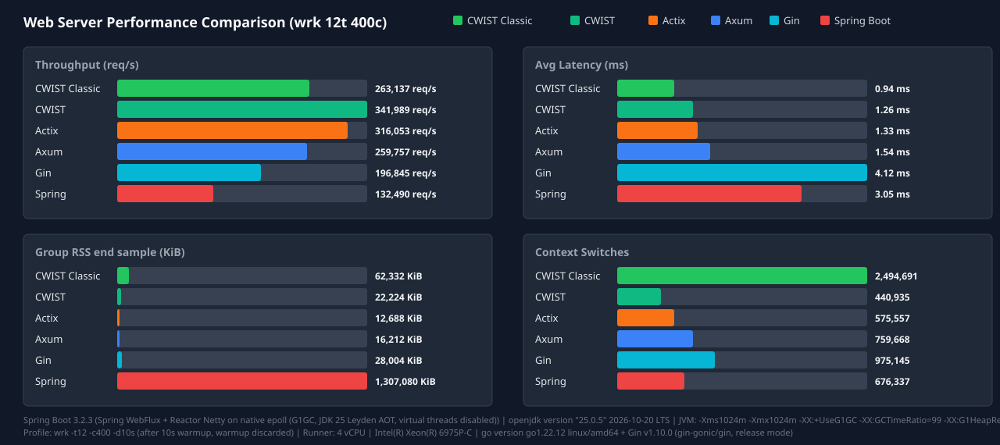
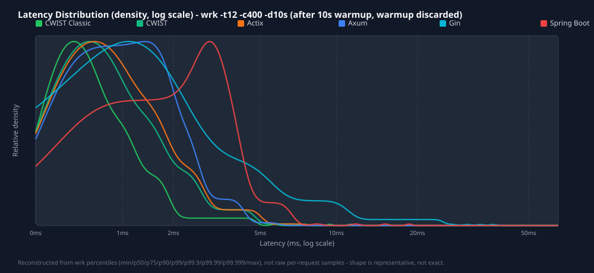

<p align="center">
  
</p>

<h1 align="center">CWIST</h1>
<p align="center"><strong>C Web development Is Still Trustworthy</strong></p>

<p align="center">
  <a href="https://discord.gg/6F8HDmNAPg"></a>
  <a href="https://oborona.zip"></a>
  <a href="https://c4punks.github.io/CWIST/"></a>
</p>

<p align="center">
<strong>Write your routes and handlers once in C. Serve them from a native server,
a WASI 0.2 edge runtime, a browser Service Worker, or bare-metal MCU firmware.</strong>
</p>

<p align="center">
<strong>Bare-metal embedded support:</strong> raw-lwIP HTTP, optional mbedTLS
HTTPS, static connection pools, and bounded response streaming on Cortex-M,
validated on a physical STM32F769I-DISCO board.
</p>

<p align="center">
CWIST is a C17 web framework and application server: routing, middleware,
templates, sessions, validation and an embedded SQLite ORM on top of HTTP/1.1,
HTTP/2, HTTP/3, WebSocket and WebTransport, with an io_uring/epoll/kqueue reactor.
</p>

<p align="center">
Bare-metal firmware uses <code>cwist_app_dispatch_memory()</code> or the raw-lwIP
adapter without BSD sockets, pthreads, epoll, or the hosted C1M reactor.
</p>

<p align="center">
  <strong>Dogfooded in production (maintainer-operated):</strong> <a href="https://oborona.zip">oborona.zip</a> (daily engineering blog) · <a href="https://github.com/gg582/fly.board">fly.board</a>
</p>

## Supported platforms

| Target | Runtime and transport | Validation and examples |
|--------|-----------------------|--------------------------|
| **Linux, macOS, BSD** | HTTP/1.1, HTTP/2, HTTP/3, TLS, WebSocket, WebTransport, io_uring/epoll/kqueue | [simple-server](example/simple-server) |
| **WASI 0.2 and browser Service Worker** | The same routes and handlers on Wasmtime or in the browser | [wasip2-kv](example/wasip2-kv), [wasm-service-worker](example/wasm-service-worker) |
| **Bare-metal STM32 and Cortex-M** | Raw-lwIP HTTP, optional mbedTLS HTTPS, static connection pools, bounded streamed responses | [STM32 guide](docs/embedded/stm32.md); STM32F769I-DISCO [fortress](example/stm32f769-fortress) (physical-board validated); NUCLEO-H743ZI2 [example](example/stm32) (reference integration: cross-build / QEMU); STM32F429I-DISCO (planned) |

## Quick start

```sh
brew tap c4punks/cwist
brew install c4punks/cwist/cwist
```

```c
#include <cwist/app.h>

static void hello(cwist_http_request *req, cwist_http_response *res) {
    (void)req;
    cwist_sstring_assign(res->body, "Hello from CWIST!");
}

int main(void) {
    cwist_app *app = cwist_app_create();
    cwist_app_get(app, "/", hello);
    cwist_app_listen(app, 8080);
    cwist_app_destroy(app);
    return 0;
}
```

```sh
gcc -o server main.c $(pkg-config --cflags --libs cwist)
./server
```

Or scaffold a hot-reloading project with `cwist new project demo && cwist watcher`.
Next steps: the 30 modules in [tutorials/](tutorials/README.md) and the guides in
[docs/](docs/README.md).

## Same routes and handlers across four targets

A CWIST app registers routes and middleware on a `cwist_app`. The same route
and handler definitions compile across four target environments, while transport
and runtime capabilities follow each host:

| Host | Entry point | What you get | Example |
|------|-------------|--------------|---------|
| **Native server** (Linux, macOS, BSD) | `cwist_app_listen(app, port)` | The full stack: HTTP/1.1–3, TLS, WebSocket, WebTransport, C1M reactor | [simple-server](example/simple-server) |
| **Browser Service Worker** | `CWIST_WASM_DEFINE_ENTRY(app)`, built with emcc | Routing, zod validation, templates, `cwist_db` and signed-cookie sessions answering `fetch` inside the browser: no origin server, no framework JS | [wasm-service-worker](example/wasm-service-worker) |
| **WASI 0.2 edge runtime** (Wasmtime) | `cwist_app_listen` on WASI sockets, built for `wasm32-wasip2` | The same app on Wasmtime; the host owns persistence as a KV-style blob | [wasip2-kv](example/wasip2-kv) |
| **Bare-metal STM32 firmware** | `cwist_app_dispatch_memory()` or the raw-lwIP adapter | Routing, middleware, JSON helpers, and HTTP/1.1 without BSD sockets or pthreads; optional mbedTLS HTTPS and bounded streaming | [STM32 guide](docs/embedded/stm32.md), [fortress](example/stm32f769-fortress) |

The WASM hosts speak serialized HTTP/1.1 across a [WIT interface](wit/cwist.wit),
and the [`cwist-wasm`](wasm/npm) npm package wraps the jco-transpiled
component for JavaScript hosts. They are newer than the
native server: read each example's README for what is and is not guaranteed
yet (for example, the wasip2 demo does not promise crash-durable writes).

## What CWIST includes

| Layer | What you get |
|-------|-------------|
| **Embedded / bare metal** | Cortex-M Thumb-2 builds; STM32F769I-DISCO (physical-board validated), NUCLEO-H743ZI2 (reference integration), and STM32F429I-DISCO (planned) examples; raw-lwIP HTTP, optional mbedTLS HTTPS, static connection pools, bounded response streaming |
| **Protocols** | HTTP/1.1, HTTP/2 (h2/h2c), HTTP/3 (QUIC, via lsquic), WebSocket, WebTransport, WebRTC data channels |
| **TLS / Security** | BoringSSL, one-call hybrid post-quantum TLS (X25519MLKEM768), ECH, certificate hot reload, JWT, CSRF, WAF, rate limiting, secure headers, encrypted DB columns |
| **Database** | SQLite3 + ORM and migrations, Nuke DB (in-memory SQLite synced to disk on COMMIT), PostgreSQL/MySQL/MariaDB detection by wire protocol |
| **Routing** | Express-style `:param` routes, mux router, chainable middleware |
| **Async handlers** | `cwist_async_defer` / `cwist_async_respond`: move blocking work to a job thread and answer later without stalling the reactor |
| **gRPC / Protobuf** | Unary and streaming routes, health/reflection, `cwist proto` code generation, and a channel client with load balancing and gRFC A6 retries |
| **Rendering** | HTML builder, scoped-CSS components, template engine, JSON builder |
| **Observability** | Structured access logs, metrics endpoint, healthz |
| **Tooling** | `cwist` CLI: scaffolding, incremental hot reload, OpenAPI 3.1 from Doxygen annotations, proto3 codegen |
| **Bindings** | [Rust](bindings/rust) and [Zig](bindings/zig) |

## Performance: throughput, latency, and tails

Every push and pull request runs CWIST against Actix, Axum, Gin and Spring Boot
under `wrk -t12 -c400 -d10s` on a GitHub runner. Methodology and fairness
settings are in [docs/webserver-benchmark.md](docs/webserver-benchmark.md);
the raw numbers for every run are in
[benchmarks/webserver.json](benchmarks/webserver.json).

**[Current CI snapshot](https://github.com/c4punks/CWIST/actions/runs/43985202645)**
(2026-11-17, commit `5db33fbdf`, 4 vCPU Intel Xeon 6975P-C,
[download `webserver-result` artifact](https://github.com/c4punks/CWIST/actions/runs/43985202645)). Each branch
uses the final entry in its own benchmark history, repeated in
[Latest benchmark run](#latest-benchmark-run). The profile is
`wrk -t12 -c400 -d10s` after a discarded 10-second warmup:

| | CWIST reactor | CWIST Classic | Actix | Axum | Gin | Spring Boot |
|---|---:|---:|---:|---:|---:|---:|
| req/s | 358,599 | 275,243 | 321,697 | 265,067 | 203,214 | 136,966 |
| Mean latency | 1.23 ms | 0.90 ms | 1.34 ms | 1.48 ms | 3.89 ms | 2.93 ms |
| p50 (median) | 0.94 ms | 0.62 ms | 1.04 ms | 1.32 ms | 1.92 ms | 2.63 ms |
| p90 | 2.72 ms | 1.89 ms | 2.81 ms | 2.66 ms | 11.02 ms | 4.13 ms |
| p99 | 4.76 ms | 4.80 ms | 5.05 ms | 4.27 ms | 25.00 ms | 6.70 ms |
| P99.999 | 15.37 ms | 22.43 ms | 11.07 ms | 9.73 ms | 54.51 ms | 42.43 ms |
| RSS | 22.0 MiB | 59.6 MiB | 12.1 MiB | 15.2 MiB | 26.8 MiB | 1.24 GiB |
| Context switches | 422,686 | 2,705,715 | 516,798 | 674,468 | 980,611 | 681,491 |

**The reactor leads throughput with the fewest context switches. Classic has
the lowest mean, median and p90 latency**, and its p99 is below Actix, Gin and
Spring Boot in both branch snapshots. **Axum retains the tighter P99.999, and
Actix the smallest RSS**; these snapshots do not hide those trade-offs. The
automatically regenerated section below may become newer than this fixed table.

### Low-concurrency latency floor

The same CI run also compares Classic and Axum under the identical lower-load
profile, `wrk -t4 -c100 -d10s` after a discarded 10-second warmup:

| | CWIST Classic | Axum |
|---|---:|---:|
| req/s | 298,719 | 278,193 |
| Mean latency | 0.232 ms | 0.348 ms |
| p50 (median) | 0.155 ms | 0.313 ms |
| p90 | 0.385 ms | 0.578 ms |
| p99 | 1.75 ms | 1.07 ms |
| P99.999 | 4.61 ms | 3.45 ms |

Classic combines higher throughput with lower mean, median and p90 latency at
this concurrency. Axum keeps the tighter p99 and extreme tail. These are
separate c100 measurements; do not compare them directly with the c400 table.

### External `the-benchmarker` / `zrk` results for v4.3.1

The [public results dataset](https://github.com/the-benchmarker/web-frameworks/blob/d75f51932e92a8e3dc17df0c5653093314bd51c9/data.json)
in [the-benchmarker/web-frameworks#10356](https://github.com/the-benchmarker/web-frameworks/pull/10356)
was generated on 2026-11-17 on an AMD Ryzen 7 5700U (16 CPUs). It records the
v4.3.1 download tag, although its version field says `4.3`. The workload is
`GET /` with `zrk --closed`, keep-alive and approximately 15 seconds per level.
[Discussion #762](https://github.com/c4punks/CWIST/discussions/762) documents
the calculations and the complete default/GC result set.

| Concurrency | CWIST req/s (rank) | CWIST GC req/s (rank) | CWIST mean ms (rank) | CWIST p99 ms (rank) | CWIST P99.999 ms (rank) |
|---:|---:|---:|---:|---:|---:|
| 64 | 193,781.31 (41/402) | 185,025.09 (51/402) | 0.3493 (55/402) | 0.4720 (15/402) | 1.5183 (32/402) |
| 256 | 176,707.29 (41/400) | 166,733.78 (55/400) | 1.5252 (57/400) | 1.8807 (19/400) | 3.9803 (15/400) |
| 512 | 170,503.71 (45/399) | 162,997.75 (53/399) | 3.1541 (58/399) | 3.4083 (20/399) | **6.2217 (5/399)** |

At 512 concurrent connections, v4.3.1's **6.2217 ms P99.999 ranks fifth of
399 implementations**, and its p99 ranks twentieth. Both CWIST variants report
zero HTTP errors, timeouts and socket connection/read/write errors at all three
levels. Throughput ranks high-to-low and latency low-to-high among results with
that metric; there is no official single overall ranking. Server CPU saturation
is approximately 69–71%, below the project's 75% saturation guideline, so this
is not presented as a fully saturated run. This external v4.3.1 snapshot is not
a per-branch measurement, and its absolute values are not directly comparable
with the different hardware and `wrk` profiles above.

### Two server modes

The mode is one environment variable; pick per workload.

- **CWIST reactor** (default, `CWIST_C1M_MODE` unset or `1`) takes throughput
  and connection density. Many connections share each event loop, so a held
  connection costs a reactor slot (about 5 KB over TLS) instead of a parked
  thread. Start here for APIs, web pages, webhooks, SSE fan-out, WebSocket
  chat and anything that holds many mostly idle connections.
- **CWIST Classic pool** (`CWIST_C1M_MODE=0`) takes median latency. Each
  connection gets its own thread, so no request waits behind another in a
  batch. Pick it for short request bursts where the median matters more than
  connection count; it cannot reach C1M, because a million threads exceeds
  `threads-max`.

### Holding a million connections

Measured on one 12-core machine (Ryzen 5 5600X, 62 GB, Linux 6.12, loopback);
commands and kernel prerequisites to reproduce each run are in
[docs/performance/https-c100k.md](docs/performance/https-c100k.md) and
[docs/c1m-file-limits.md](docs/c1m-file-limits.md):

| Run | Result | Server memory |
|-----|--------|---------------|
| C1M cleartext, reactor, 12 workers (2026-09-29) | 1,000,000 / 1,000,000 responded | ~22.9 GiB peak RSS (~24 KB per connection) |
| C100K HTTPS, reactor, 4 workers (2026-10-17) | 100,000 / 100,000 established, 0 dropped, all answered | 4,975 B per open connection |
| C1M HTTPS, reactor (2026-10-18) | 1,000,000 / 1,000,000 established, 0 dropped, all answered | 4.56 GiB above idle (4,866 B per open connection) |
| C1M over TLS HTTP/1.1 and HTTP/2 via [fly.board](https://github.com/gg582/fly.board#scalability-benchmark) | 1,000,000 / 1,000,000 held and served, zero failures | 19.9 GB / 30.1 GB PSS |

The HTTPS ramp is handshake-bound (~2,900 full P-256 handshakes/s, so ~340 s to
open 1M connections).

On the async path, established HTTP/1.1 TLS connections are served on the C1M
reactor by default (`CWIST_HTTPS_REACTOR=1`). TLS handshakes and HTTP/2
requests continue to use HTTPS pool threads; setting `CWIST_HTTPS_REACTOR=0`
restores pool-based HTTP/1.1 handling. A handler that writes faster than the
socket drains waits inside the reactor thread (bounded by
`CWIST_HTTP_TIMEOUT_MS`). Idle cleartext keep-alive connections are closed by
a per-worker sweep timer once they wait longer than
`CWIST_HTTP_KEEP_ALIVE_TIMEOUT` (default 15 s), counted in
`cwist_http_idle_reaped_total`.

## Why C, when Axum and Gin exist?

1. **Your C and C++ code is already the backend.** Libraries for finance,
   game servers, ML inference or device control link straight into the server
   with no FFI layer, no serialization boundary and no second runtime.
2. **The same routes and handlers reach the browser, the edge, and MCUs.** C
   compiles to WASM and bare-metal targets with mature toolchains, which lets
   shared handler logic run across the hosts above.
3. **Predictable footprint and start-up.** No garbage collector, VM or JIT
   warm-up: the reactor's RSS is above the Rust frameworks but below Go and
   about 60× below the JVM.
4. **Competitive throughput and median latency**, with the tail trade-off
   stated in the table above rather than hidden.

## Memory safety and security in C

The first question about a C web server is buffer overflows, use-after-free and
leaks. What CWIST does about it, and where each check lives:

- **Sanitizers on every push and PR.** The test suite, tutorials and examples
  build with `SANITIZE=address,undefined WERROR=1` and run under ASan/UBSan
  ([asan.yml](.github/workflows/asan.yml)); ThreadSanitizer, CodeQL and
  cppcheck run in their own workflows.
- **Protocol conformance.** An h2spec HTTP/2 run is diffed against a pinned
  baseline (`scripts/ci/h2spec-baseline.txt`); regressions fail the build.
- **Allocator gate.** New raw `malloc`/`free` calls in the framework fail
  `cwist audit --gate` against `scripts/ci/malloc-baseline.txt`
  ([malloc_lint.sh](scripts/ci/malloc_lint.sh)).
- **Fuzzing.** libFuzzer + ASan/UBSan targets (`make fuzz`) exercise the
  sequenced-chunk assembler ([tests/fuzz_seq.c](tests/fuzz_seq.c)), HTTP/1.1
  request/query/cookie/date/multipart parsers
  ([tests/fuzz_http1.c](tests/fuzz_http1.c)), HTTP/2 HPACK and frame handling
  ([tests/fuzz_http2.c](tests/fuzz_http2.c)), HTTP/3 QPACK header validation and
  QUIC packet-in paths ([tests/fuzz_http3.c](tests/fuzz_http3.c)), WebSocket
  frame and UTF-8 parsing ([tests/fuzz_websocket.c](tests/fuzz_websocket.c)),
  and reverse-proxy URL/header/body sanitization
  ([tests/fuzz_proxy.c](tests/fuzz_proxy.c)).
- **Deterministic lifetimes.** Request buffers and cached replies live in
  libttak generational arenas and epoch-based reclamation critical sections.
  Deferred responses use an explicit ownership handoff, and
  `CWIST_ASYNC_STRICT=1` turns misuse into an abort instead of a warning.
- **Built-in security controls and opt-in PQC TLS.** Default HTTPS enforces TLS
  1.2+ with AEAD cipher suites (`X25519:P-256`), while
  `cwist_app_use_pqc_layer(app, true)` opts into hybrid post-quantum key
  exchange (`X25519MLKEM768:X25519:P-256`) and a TLS 1.3 minimum. Built-in
  middleware and session helpers provide WAF checks, token-bucket rate limiting,
  timing-safe HMAC session verification, CSRF tokens and strict security headers
  (HSTS, COOP, Permissions-Policy).

Design decisions and their current status are recorded in
[docs/decisions/](docs/decisions/README.md).

## Install

CWIST vendors its dependencies (BoringSSL, lsquic, libttak, SQLite3), so a plain
build works on a fresh Linux, macOS, or BSD machine:

```sh
git clone https://github.com/c4punks/CWIST.git
cd cwist
make
sudo make install        # optional, installs to /usr/local (override with PREFIX=/opt/cwist)
```

### Homebrew

macOS and Linux (Linuxbrew) users can install the latest release from the
[CWIST tap](https://github.com/c4punks/homebrew-cwist):

```sh
brew tap c4punks/cwist
brew install cwist
```

The formula builds from the release source tarball
(`dist/cwist-<version>.tar.gz`, vendored dependencies included) and installs
`libcwist.a`, public headers, the `cwist` CLI, and `cwist.pc` pkg-config
metadata under the Homebrew prefix.

## Platform support

CWIST builds on Linux, macOS, and BSD. On Linux the reactor uses `io_uring`
(raw syscalls, no liburing) and falls back to epoll if ring setup fails;
macOS and BSD use kqueue. The HTTP/3 server and native client use non-blocking
UDP sockets on every platform, and ECN metadata is enabled only when the host
exposes the required socket options. Reactor internals (one-shot polls vs
completion-staged receives, `CWIST_RX_URING`, latency probes) are described in
[docs/http-reactor-fairness.md](docs/http-reactor-fairness.md) and
[docs/runtime-config.md](docs/runtime-config.md).

## Bare-metal STM32

CWIST also provides a socket-free Cortex-M path for firmware that uses
`cwist_app_dispatch_memory()` or the raw-lwIP adapter. The same routing,
middleware, handlers, JSON helpers, and HTTP/1.1 parser are available without
`cwist_app_listen()`, pthreads, epoll, or the C1M reactor.

Each board carries exactly one of three labels:

| Board | Status | What backs it |
|-------|--------|---------------|
| STM32F769I-DISCO | **Physical-board validated** | Flashed and run on real hardware ([example/stm32f769](example/stm32f769), [fortress](example/stm32f769-fortress)) |
| NUCLEO-H743ZI2 | **Reference integration (cross-build / QEMU)** | Cross-built; not yet run on a physical board ([example/stm32](example/stm32)) |
| STM32F429I-DISCO | **Planned** | Low-resource target; hardware on hand, not validated yet |

- **Validated on STM32F769I-DISCO:** raw-lwIP HTTP, mbedTLS HTTPS, static
  connection pools, and streamed responses through bounded TX buffers.
- **LCD and load demo:** `example/stm32f769-fortress/` exposes 288 real
  connection-pool slots on the 800x480 LCD and browser dashboard, with
  selectable responses up to 1 MiB.
- **Reference integration:** NUCLEO-H743ZI2 application, HAL hooks, and lwIP
  options. It is cross-built only and has not been run on a physical board.
- **Automated checks (not hardware validation):**
  [`baremetal.yml`](.github/workflows/baremetal.yml) builds Cortex-M7 Thumb-2
  firmware with `arm-none-eabi-gcc` and runs it under `qemu-arm` semihosting
  (`make baremetal-smoke`, `make baremetal-size-gate`);
  [`cross-compile.yml`](.github/workflows/cross-compile.yml) cross-builds
  `fat-dist` for embedded Linux triplets and link-smokes it under qemu-user.
  Passing either says nothing about a board's PHY, clock tree, NVIC, or RNG.

Build inputs and the lwIP/TLS integration are documented in
[docs/embedded/stm32.md](docs/embedded/stm32.md). Board-specific wiring,
cache constraints, and flashing instructions live in the example READMEs.

## The cwist CLI and hot reload

`make install` also installs the `cwist` command line tool into `$(PREFIX)/bin`.

```sh
# Scaffold a project: src/main.c, Makefile, and a demo.cwpro manifest
cwist new project demo --directory ~/src
cd ~/src/demo

# Develop with hot reload (incremental rebuild + zero-downtime restart)
cwist watcher

# Generate OpenAPI 3.1 from Doxygen @openapi.* route annotations
cwist openapi

# Generate C models and gRPC method paths from proto3 definitions
cwist proto api.proto

# Inspect the project manifest and detected routes
cwist describe
```

The watcher rebuilds only the affected translation units and restarts the app
only after a successful build, so the previous process keeps serving if a build
fails. It wakes on `inotify` (Linux) or `kqueue` (BSD/macOS) with a polling
fallback; `--no-run` rebuilds without running and `--poll` forces polling. The
`.cwpro` manifest (`cwist-project/v1`) holds the entry point, include paths,
debounce/stop timeouts and route discovery scope for the watcher and generators.

## Linking

`libcwist.a` is a **thin static archive**: it contains only CWIST objects.
`make install` installs the vendored libraries under `$(PREFIX)/lib/cwist` and
their headers under `$(PREFIX)/include/cwist/vendor`. pkg-config resolves all of
it:

```sh
gcc -o server main.c $(pkg-config --cflags --libs cwist)
# fully static:
gcc -o server main.c $(pkg-config --cflags --libs --static cwist)
```

Without pkg-config, link CWIST first and its dependencies after it:

```sh
gcc -I/opt/cwist/include -I/opt/cwist/include/cwist/vendor main.c \
    -L/opt/cwist/lib -L/opt/cwist/lib/cwist -lcwist \
    -llsquic -lssl -lcrypto -lnats_static -lttak -lcjson -luriparser \
    -lz -lzstd -lbrotlienc -lbrotlicommon -ldl -lpthread -lm -lstdc++
```

`-lnghttp2` (HTTP/2) and `-lcurl` (RDBMS auto-mount probing) are optional.
Brotli ships as `libbrotli-dev` on Debian/Ubuntu and `brotli-devel` on
Fedora/RHEL; zstd as `libzstd-dev` / `libzstd-devel`. `DESTDIR` is supported for
staged packages.

## Configuration

CWIST reads `.env` files and prefixed environment variables:

```c
cwist_config *cfg = cwist_config_create();
cwist_config_load_file(cfg, ".env");
cwist_config_load_env(cfg, "CWIST_");

const char *db_url = cwist_config_get(cfg, "DATABASE_URL");
int workers       = cwist_config_get_int(cfg, "WORKERS", 4);
bool debug        = cwist_config_get_bool(cfg, "DEBUG", false);

cwist_config_destroy(cfg);
```

The framework itself reads these without a prefix; every `CWIST_*` variable,
with its default and v4 support status, is in
[docs/runtime-config.md](docs/runtime-config.md).

| Variable | Default | Description |
|----------|---------|-------------|
| `CWIST_WORKERS` | `1` | Worker processes to fork before entering the event loop. |
| `CWIST_C1M_MODE` | `true` | `1` selects the CWIST reactor, `0` the Classic pool. |
| `CWIST_HTTP_BATCH` | `16` | Pipelined HTTP/1.1 requests dispatched per event-loop turn (clamped to `[1, 1024]`). |
| `CWIST_HTTP_YIELD_BATCH` | `16` | Dispatch yield granularity within a batch before re-posting the connection. |
| `CWIST_ASYNC_DEBUG` | unset | Log rare reactor failure events (rearm/submit/SQ failures) to stderr. |
| `CWIST_ASYNC_STRICT` | unset | `1` aborts on deferred-response misuse instead of warning once. |

## Feature notes

**PQC TLS.** `cwist_app_use_pqc_layer(app, true)` forces
`X25519MLKEM768:X25519:P-256`, sets TLS 1.3 as the minimum and strips legacy
ciphers. Application code never touches OpenSSL directly.

**WebTransport.** `cwist_app_use_webtransport(app, handler)` handles the CONNECT
negotiation over HTTP/3 and exposes
`cwist_webtransport_read/write/flush/close/open_bidi/open_uni`.

**Nuke DB.** `cwist_nuke_init("data.db", 5000)` loads an on-disk SQLite file
into memory with `sqlite3_deserialize`, runs `PRAGMA integrity_check`, serves
every query from RAM and syncs to disk on COMMIT. If bootstrap fails, it falls
back to read-only disk protection mode.

**RDBMS auto-mount.** `cwist_app_auto_rdbms(app, 5432)` classifies the server by
wire protocol (a PostgreSQL StartupMessage or a MySQL handshake packet) instead
of guessing from the port number.

**libttak.** The in-tree allocator/reactor toolkit provides generational arenas,
epoch-based reclamation, signal-safe detachable arenas for TLS and WebSocket
buffers, and a lock-free job queue.

## Latest benchmark run

CI regenerates this block from each benchmark run.

<!-- WEBSERVER_BENCHMARKS:START -->
Latest Web Server Benchmark (wrk -t12 -c400 -d10s (after 10s warmup, warmup discarded)):
- **CWIST Classic pool**: 275243 req/s | Latency 0.90ms (P50 0.62ms, P90 1.89ms, P99 4.80ms, P99.999 22.43ms) | RSS 61000KiB | Csw 2705715
- **CWIST reactor**: 358599 req/s | Latency 1.23ms (P50 0.94ms, P90 2.72ms, P99 4.76ms, P99.999 15.37ms) | RSS 22516KiB | Csw 422686
- **Actix**: 321697 req/s | Latency 1.34ms (P50 1.04ms, P90 2.81ms, P99 5.05ms, P99.999 11.07ms) | RSS 12404KiB | Csw 516798
- **Axum**: 265067 req/s | Latency 1.48ms (P50 1.32ms, P90 2.66ms, P99 4.27ms, P99.999 9.73ms) | RSS 15528KiB | Csw 674468
- **Gin (Go)**: 203214 req/s | Latency 3.89ms (P50 1.92ms, P90 11.02ms, P99 25.00ms, P99.999 54.51ms) | RSS 27488KiB | Csw 980611
- **Spring Boot**: 136966 req/s | Latency 2.93ms (P50 2.63ms, P90 4.13ms, P99 6.70ms, P99.999 42.43ms) | RSS 1297636KiB | Csw 681491

_Settled CWIST-internal tuning variants (glibc arena cap from PR #35, cooperative drain chunk from issue #25) are recorded in docs/cooperative-queuing.md and benchmarks/webserver.json; they are no longer rendered as comparison rows._

**Spring runtime environment**

- **JDK:** `openjdk version "25.0.5" 2026-10-20 LTS`
- **Spring Boot:** 3.2.3
- **Stack:** Spring WebFlux + Reactor Netty on native epoll (G1GC, JDK 25 Leyden AOT, virtual threads disabled)
- **Virtual threads:** disabled

**JVM options**

```text
-Xms1024m
-Xmx1024m
-XX:+UseG1GC
-XX:GCTimeRatio=99
-XX:G1HeapRegionSize=1m
-XX:+AlwaysPreTouch
-XX:CompileThreshold=1500
-XX:CICompilerCount=4
-Djava.security.egd=file:/dev/urandom
-Djava.net.preferIPv4Stack=true
-Dio.netty.allocator.type=pooled
-Dio.netty.leakDetection.level=disabled
-Dio.netty.buffer.checkBounds=false
-Dio.netty.buffer.checkAccessible=false
-Dreactor.netty.ioWorkerCount=4
-Xlog:gc*:file=/tmp/spring_gc.log:time,uptime,level,tags
-XX:+AOTClassLinking
-XX:AOTCache=/tmp/spring_bench/app.aot (JEP 483 + JEP 514 single-step AOT)
```

**Warmup/profile**

wrk -t12 -c400 -d10s (after 10s warmup, warmup discarded)



Latency distribution (density curve reconstructed from each server's percentiles - shows the shape of the tail, not just its P99.999 number):


<!-- WEBSERVER_BENCHMARKS:END -->

_Methodology, JVM options, and fairness settings: [docs/webserver-benchmark.md](docs/webserver-benchmark.md)_

## Stability and conformance

- **Versioning**: v4 is the first LTS line. Draft-level features cycle through
  `dev` and may appear or disappear between tags; pin an exact tag in
  production. See [docs/versioning.md](docs/versioning.md).
- **Conformance gates**: ASan/UBSan with `-Werror` on every push, and an h2spec
  HTTP/2 diff against a pinned baseline; known gaps are tracked in
  `scripts/ci/h2spec-baseline.txt`.

## Documentation

The full map is [docs/README.md](docs/README.md). In suggested reading order:

- **[Tutorials](tutorials/README.md)**: 30 hands-on modules, each with a runnable `main.c`, a `CMakeLists.txt` and a guided README.
- **[Guides](docs/tutorials/)**: [CRUD blog](docs/tutorials/blog-crud.md), [NATS integration](docs/tutorials/nats-integration.md), [WebTransport server](docs/tutorials/webtransport-server.md).
- **[API reference](docs/API.md)**: per-module docs under `docs/api/`, the [flat quick reference](docs/api-quickref.md) and generated [Doxygen HTML](https://c4punks.github.io/CWIST/).
- **[Decision records](docs/decisions/README.md)** and **[ROADMAP.md](ROADMAP.md)**.

## Examples

Runnable demos under [example/](example/): a [minimal server](example/simple-server),
[step-by-step HTTP](example/http), [SQLite](example/db) and
[encrypted-column DB](example/db-crypt), [JWT auth](example/jwt), a
[WebSocket Othello game](example/othello-web), [WebRTC](example/webrtc),
[WebTransport](example/webtransport), the WASM hosts
([Service Worker](example/wasm-service-worker), [wasip2](example/wasip2-kv)),
[Rust](example/rust-hello) and [Zig](example/zig-hello) hello-worlds, and the
[rps-showcase](example/rps-showcase) throughput demo. The
[examples table](docs/README.md#4-runnable-examples) lists them all.

Maintainer-operated production deployments built on CWIST: [oborona.zip](https://oborona.zip) (live daily engineering blog) and [fly.board](https://github.com/gg582/fly.board).

## Community

The official CWIST Discord: **https://discord.gg/6F8HDmNAPg**. Questions, design
discussion and contribution coordination happen there; see
[CONTRIBUTING.md](CONTRIBUTING.md) to send a patch.

## Third-party licenses

CWIST vendors its dependencies under `lib/`; each keeps its own license (summary
in [NOTICE.md](NOTICE.md), authoritative text in each submodule's license file):

| Component | License |
|-----------|---------|
| BoringSSL | Apache-2.0 |
| lsquic | MIT (some Chromium-derived parts BSD-3-Clause) |
| cJSON, multipart-parser-c | MIT |
| libttak | BSD-3-Clause |
| SQLite | Public Domain |
| cnats | Apache-2.0 |
| uriparser | BSD-3-Clause (library only; its test suite is LGPL-2.1-or-later and is not linked) |

Static linking propagates each component's license obligations to linked
binaries; review [NOTICE.md](NOTICE.md) when distributing.
