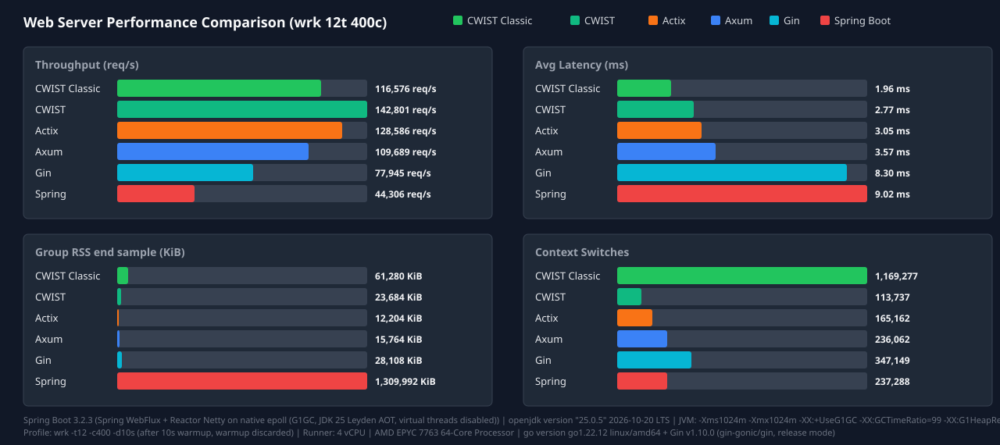
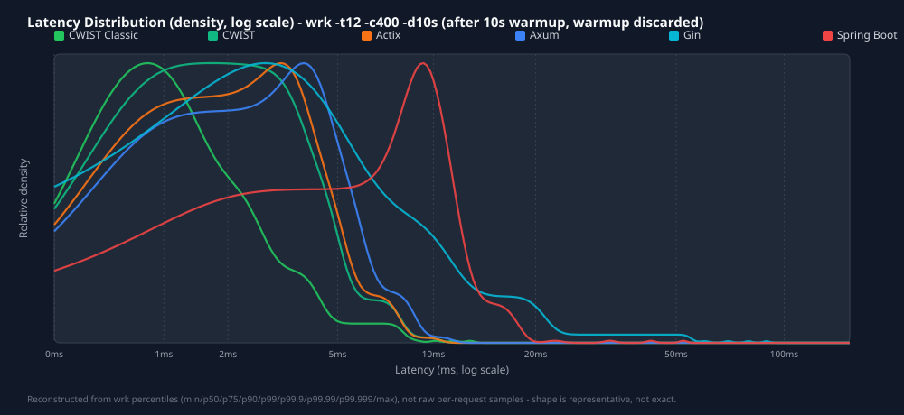

<p align="center">
  
</p>

<h1 align="center">CWIST</h1>
<p align="center"><strong>C Web development Is Still Trustworthy</strong></p>

<p align="center">
  <a href="https://discord.gg/6F8HDmNAPg"></a>
  <a href="https://oborona.zip"></a>
  <a href="https://c4punks.github.io/CWIST/"></a>
</p>

<p align="center">
<strong>Write a web app once in C. Serve it from a native server, from a WASI 0.2
edge runtime, or from inside the browser's Service Worker.</strong>
</p>

<p align="center">
CWIST is a C17 web framework and application server: routing, middleware,
templates, sessions, validation and an embedded SQLite ORM on top of HTTP/1.1,
HTTP/2, HTTP/3, WebSocket and WebTransport, with an io_uring/epoll/kqueue reactor.
</p>

<p align="center">
  <strong>Powered by CWIST in production:</strong> <a href="https://oborona.zip">oborona.zip</a> (daily engineering blog) · <a href="https://github.com/gg582/fly.board">fly.board</a>
</p>

## Quick start

```sh
brew tap c4punks/cwist
brew install c4punks/cwist/cwist
```

```c
#include <cwist/app.h>

static void hello(cwist_http_request *req, cwist_http_response *res) {
    (void)req;
    cwist_sstring_assign(res->body, "Hello from CWIST!");
}

int main(void) {
    cwist_app *app = cwist_app_create();
    cwist_app_get(app, "/", hello);
    cwist_app_listen(app, 8080);
    cwist_app_destroy(app);
    return 0;
}
```

```sh
gcc -o server main.c $(pkg-config --cflags --libs cwist)
./server
```

Or scaffold a hot-reloading project with `cwist new project demo && cwist watcher`.
Next steps: the 30 modules in [tutorials/](tutorials/README.md) and the guides in
[docs/](docs/README.md).

## One app, three places to run it

A CWIST app is a set of routes on a `cwist_app`. Where it runs depends only on
how you hand that app to a host:

| Host | Entry point | What you get | Example |
|------|-------------|--------------|---------|
| **Native server** (Linux, macOS, BSD) | `cwist_app_listen(app, port)` | The full stack: HTTP/1.1–3, TLS, WebSocket, WebTransport, C1M reactor | [simple-server](example/simple-server) |
| **Browser Service Worker** | `CWIST_WASM_DEFINE_ENTRY(app)`, built with emcc | Routing, zod validation, templates, `cwist_db` and signed-cookie sessions answering `fetch` inside the browser: no origin server, no framework JS | [wasm-service-worker](example/wasm-service-worker) |
| **WASI 0.2 edge runtime** (Wasmtime) | `cwist_app_listen` on WASI sockets, built for `wasm32-wasip2` | The same app on Wasmtime; the host owns persistence as a KV-style blob | [wasip2-kv](example/wasip2-kv) |

The WASM hosts speak serialized HTTP/1.1 across a [WIT interface](wit/cwist.wit),
and the [`cwist-wasm`](wasm/npm) npm package wraps both the Emscripten module
and the jco-transpiled component for JavaScript hosts. They are newer than the
native server: read each example's README for what is and is not guaranteed
yet (for example, the wasip2 demo does not promise crash-durable writes).

## What CWIST includes

| Layer | What you get |
|-------|-------------|
| **Protocols** | HTTP/1.1, HTTP/2 (h2/h2c), HTTP/3 (QUIC, via lsquic), WebSocket, WebTransport, WebRTC data channels |
| **TLS / Security** | BoringSSL, one-call hybrid post-quantum TLS (X25519MLKEM768), ECH, certificate hot reload, JWT, CSRF, WAF, rate limiting, secure headers, encrypted DB columns |
| **Database** | SQLite3 + ORM and migrations, Nuke DB (in-memory SQLite synced to disk on COMMIT), PostgreSQL/MySQL/MariaDB detection by wire protocol |
| **Routing** | Express-style `:param` routes, mux router, chainable middleware |
| **Async handlers** | `cwist_async_defer` / `cwist_async_respond`: move blocking work to a job thread and answer later without stalling the reactor |
| **gRPC / Protobuf** | Unary and streaming routes, health/reflection, `cwist proto` code generation, and a channel client with load balancing and gRFC A6 retries |
| **Rendering** | HTML builder, scoped-CSS components, template engine, JSON builder |
| **Observability** | Structured access logs, metrics endpoint, healthz |
| **Tooling** | `cwist` CLI: scaffolding, incremental hot reload, OpenAPI 3.1 from Doxygen annotations, proto3 codegen |
| **Bindings** | [Rust](bindings/rust) and [Zig](bindings/zig) |

## Performance, including where it loses

Every push and pull request runs CWIST against Actix, Axum, Gin and Spring Boot under
`wrk -t12 -c400 -d10s` on a GitHub runner. A single run moves with the runner's
CPU model, so read the record across runs rather than one row.

**CI record as of 2026-10-20** (100 runs since 2026-09-15, `benchmarks/webserver.json`):

| Comparison | Result |
|------------|--------|
| CWIST reactor throughput vs Axum | Higher in 100 of 100 runs (median +24%) |
| CWIST reactor throughput vs Actix | Higher in 40 of the 42 runs that included Actix; the latest run is a tie |
| CWIST Classic pool median latency vs Axum | Lower in 100 of 100 runs (median: half of Axum's) |
| CWIST Classic pool p99 vs Axum | Lower in 69 of 100 runs |
| CWIST reactor P99.999 vs Axum | Lower in only 45 of 100 runs: **Axum's extreme tail is usually tighter**, and closing that is open work |
| Memory (latest run) | Reactor RSS 22 MiB, in the same class as Actix (12 MiB) and Axum (17 MiB), below Gin (29 MiB), about 60× below the JVM row (1.3 GiB) |

The full latest run, the trend chart, the latency density curves and the
per-CPU medians follow in the [benchmark section](#latest-benchmark-run).
Methodology and fairness settings are in
[docs/webserver-benchmark.md](docs/webserver-benchmark.md).

### Two server modes

The mode is one environment variable; pick per workload.

- **CWIST reactor** (default, `CWIST_C1M_MODE` unset or `1`) takes throughput
  and connection density. Many connections share each event loop, so a held
  connection costs a reactor slot (about 5 KB over TLS) instead of a parked
  thread. Start here for APIs, web pages, webhooks, SSE fan-out, WebSocket
  chat and anything that holds many mostly idle connections.
- **CWIST Classic pool** (`CWIST_C1M_MODE=0`) takes median latency. Each
  connection gets its own thread, so no request waits behind another in a
  batch. Pick it for short request bursts where the median matters more than
  connection count; it cannot reach C1M, because a million threads exceeds
  `threads-max`.

### Holding a million connections

Measured on one 12-core machine (Ryzen 5 5600X, 62 GB, Linux 6.12, loopback):

| Run | Result | Server memory |
|-----|--------|---------------|
| C1M cleartext, reactor, 12 workers (2026-09-29) | 1,000,000 / 1,000,000 responded | ~22.9 GiB peak RSS (~24 KB per connection) |
| C100K HTTPS, reactor, 4 workers (2026-10-17) | 100,000 / 100,000 established, 0 dropped, all answered | 4,975 B per open connection |
| C1M HTTPS, reactor (2026-10-18) | 1,000,000 / 1,000,000 established, 0 dropped, all answered | 4.56 GiB above idle (4,866 B per open connection) |
| C1M over TLS HTTP/1.1 and HTTP/2 via [fly.board](https://github.com/gg582/fly.board#scalability-benchmark) | 1,000,000 / 1,000,000 held and served, zero failures | 19.9 GB / 30.1 GB PSS |

The HTTPS ramp is handshake-bound (~2,900 full P-256 handshakes/s, so ~340 s to
open 1M connections). Kernel prerequisites, the client tooling fixes the runs
needed, and the per-run details are in
[docs/performance/https-c100k.md](docs/performance/https-c100k.md) and
[docs/c1m-file-limits.md](docs/c1m-file-limits.md).

Known limits of the async path: HTTPS still runs the request phase on pool
threads, a handler that writes faster than the socket drains waits inside the
reactor thread (bounded by `CWIST_HTTP_TIMEOUT_MS`), and idle cleartext
keep-alive connections are not yet reaped by a timer.

## Why C, when Axum and Gin exist?

1. **Your C and C++ code is already the backend.** Libraries for finance,
   game servers, ML inference or device control link straight into the server
   with no FFI layer, no serialization boundary and no second runtime.
2. **The same app reaches the browser and the edge.** C compiles to WASM with
   mature toolchains, which is what lets one CWIST app run in all three hosts
   above.
3. **Predictable footprint and start-up.** No garbage collector, VM or JIT
   warm-up: the reactor sits in the same memory class as the Rust frameworks
   and far below the JVM.
4. **Competitive throughput and median latency**, with the tail trade-off
   stated in the CI record above rather than hidden.

## Memory safety and security in C

The first question about a C web server is buffer overflows, use-after-free and
leaks. What CWIST does about it, and where each check lives:

- **Sanitizers on every push and PR.** The test suite, tutorials and examples
  build with `SANITIZE=address,undefined WERROR=1` and run under ASan/UBSan
  ([asan.yml](.github/workflows/asan.yml)); ThreadSanitizer, CodeQL and
  cppcheck run in their own workflows.
- **Protocol conformance.** An h2spec HTTP/2 run is diffed against a pinned
  baseline (`scripts/ci/h2spec-baseline.txt`); regressions fail the build.
- **Allocator gate.** New raw `malloc`/`free` calls in the framework fail
  `cwist audit --gate` against `scripts/ci/malloc-baseline.txt`
  ([malloc_lint.sh](scripts/ci/malloc_lint.sh)).
- **Fuzzing.** A libFuzzer target covers the sequenced-chunk assembler
  (`make fuzz_seq`, [tests/fuzz_seq.c](tests/fuzz_seq.c)). Fuzz targets for
  the HTTP/1.1, HTTP/2, WebSocket and multipart parsers are not written yet,
  and contributions are welcome.
- **Deterministic lifetimes.** Request buffers and cached replies live in
  libttak generational arenas and epoch-based reclamation critical sections.
  Deferred responses use an explicit ownership handoff, and
  `CWIST_ASYNC_STRICT=1` turns misuse into an abort instead of a warning.
- **Secure defaults.** Hybrid post-quantum TLS with TLS 1.3 minimum, a built-in
  WAF, token-bucket rate limiting, timing-safe HMAC session verification, CSRF
  tokens and strict security headers (HSTS, COOP, Permissions-Policy).

Design decisions and their current status are recorded in
[docs/decisions/](docs/decisions/README.md).

## Install

CWIST vendors its dependencies (BoringSSL, lsquic, libttak, SQLite3), so a plain
build works on a fresh Linux, macOS, or BSD machine:

```sh
git clone https://github.com/c4punks/CWIST.git
cd cwist
make
sudo make install        # optional, installs to /usr/local (override with PREFIX=/opt/cwist)
```

### Homebrew

macOS and Linux (Linuxbrew) users can install the latest release from the
[CWIST tap](https://github.com/c4punks/homebrew-cwist):

```sh
brew tap c4punks/cwist
brew install cwist
```

The formula builds from the release source tarball
(`dist/cwist-<version>.tar.gz`, vendored dependencies included) and installs
`libcwist.a`, public headers, the `cwist` CLI, and `cwist.pc` pkg-config
metadata under the Homebrew prefix.

## Platform support

CWIST builds on Linux, macOS, and BSD. On Linux the reactor uses `io_uring`
(raw syscalls, no liburing) and falls back to epoll if ring setup fails;
macOS and BSD use kqueue. The HTTP/3 server and native client use non-blocking
UDP sockets on every platform, and ECN metadata is enabled only when the host
exposes the required socket options. Reactor internals (one-shot polls vs
completion-staged receives, `CWIST_RX_URING`, latency probes) are described in
[docs/http-reactor-fairness.md](docs/http-reactor-fairness.md) and
[docs/runtime-config.md](docs/runtime-config.md).

## The cwist CLI and hot reload

`make install` also installs the `cwist` command line tool into `$(PREFIX)/bin`.

```sh
# Scaffold a project: src/main.c, Makefile, and a demo.cwpro manifest
cwist new project demo --directory ~/src
cd ~/src/demo

# Develop with hot reload (incremental rebuild + zero-downtime restart)
cwist watcher

# Generate OpenAPI 3.1 from Doxygen @openapi.* route annotations
cwist openapi

# Generate C models and gRPC method paths from proto3 definitions
cwist proto api.proto

# Inspect the project manifest and detected routes
cwist describe
```

The watcher rebuilds only the affected translation units and restarts the app
only after a successful build, so the previous process keeps serving if a build
fails. It wakes on `inotify` (Linux) or `kqueue` (BSD/macOS) with a polling
fallback; `--no-run` rebuilds without running and `--poll` forces polling. The
`.cwpro` manifest (`cwist-project/v1`) holds the entry point, include paths,
debounce/stop timeouts and route discovery scope for the watcher and generators.

## Linking

`libcwist.a` is a **thin static archive**: it contains only CWIST objects.
`make install` installs the vendored libraries under `$(PREFIX)/lib/cwist` and
their headers under `$(PREFIX)/include/cwist/vendor`. pkg-config resolves all of
it:

```sh
gcc -o server main.c $(pkg-config --cflags --libs cwist)
# fully static:
gcc -o server main.c $(pkg-config --cflags --libs --static cwist)
```

Without pkg-config, link CWIST first and its dependencies after it:

```sh
gcc -I/opt/cwist/include -I/opt/cwist/include/cwist/vendor main.c \
    -L/opt/cwist/lib -L/opt/cwist/lib/cwist -lcwist \
    -llsquic -lssl -lcrypto -lnats_static -lttak -lcjson -luriparser \
    -lz -lzstd -lbrotlienc -lbrotlicommon -ldl -lpthread -lm -lstdc++
```

`-lnghttp2` (HTTP/2) and `-lcurl` (RDBMS auto-mount probing) are optional.
Brotli ships as `libbrotli-dev` on Debian/Ubuntu and `brotli-devel` on
Fedora/RHEL; zstd as `libzstd-dev` / `libzstd-devel`. `DESTDIR` is supported for
staged packages.

## Configuration

CWIST reads `.env` files and prefixed environment variables:

```c
cwist_config *cfg = cwist_config_create();
cwist_config_load_file(cfg, ".env");
cwist_config_load_env(cfg, "CWIST_");

const char *db_url = cwist_config_get(cfg, "DATABASE_URL");
int workers       = cwist_config_get_int(cfg, "WORKERS", 4);
bool debug        = cwist_config_get_bool(cfg, "DEBUG", false);

cwist_config_destroy(cfg);
```

The framework itself reads these without a prefix; every `CWIST_*` variable,
with its default and v4 support status, is in
[docs/runtime-config.md](docs/runtime-config.md).

| Variable | Default | Description |
|----------|---------|-------------|
| `CWIST_WORKERS` | `1` | Worker processes to fork before entering the event loop. |
| `CWIST_C1M_MODE` | `true` | `1` selects the CWIST reactor, `0` the Classic pool. |
| `CWIST_HTTP_BATCH` | `16` | Pipelined HTTP/1.1 requests dispatched per event-loop turn (clamped to `[1, 1024]`). |
| `CWIST_HTTP_YIELD_BATCH` | `16` | Dispatch yield granularity within a batch before re-posting the connection. |
| `CWIST_ASYNC_DEBUG` | unset | Log rare reactor failure events (rearm/submit/SQ failures) to stderr. |
| `CWIST_ASYNC_STRICT` | unset | `1` aborts on deferred-response misuse instead of warning once. |

## Feature notes

**PQC TLS.** `cwist_app_use_pqc_layer(app, true)` forces
`X25519MLKEM768:X25519:P-256`, sets TLS 1.3 as the minimum and strips legacy
ciphers. Application code never touches OpenSSL directly.

**WebTransport.** `cwist_app_use_webtransport(app, handler)` handles the CONNECT
negotiation over HTTP/3 and exposes
`cwist_webtransport_read/write/flush/close/open_bidi/open_uni`.

**Nuke DB.** `cwist_nuke_init("data.db", 5000)` loads an on-disk SQLite file
into memory with `sqlite3_deserialize`, runs `PRAGMA integrity_check`, serves
every query from RAM and syncs to disk on COMMIT. If bootstrap fails, it falls
back to read-only disk protection mode.

**RDBMS auto-mount.** `cwist_app_auto_rdbms(app, 5432)` classifies the server by
wire protocol (a PostgreSQL StartupMessage or a MySQL handshake packet) instead
of guessing from the port number.

**libttak.** The in-tree allocator/reactor toolkit provides generational arenas,
epoch-based reclamation, signal-safe detachable arenas for TLS and WebSocket
buffers, and a lock-free job queue.

## Latest benchmark run

CI regenerates this block from each benchmark run.

<!-- WEBSERVER_BENCHMARKS:START -->
Latest Web Server Benchmark (wrk -t12 -c400 -d10s (after 10s warmup, warmup discarded)):
- **CWIST Classic pool**: 199795 req/s | Latency 1.16ms (P90 2.41ms, P99 4.98ms, P99.999 20.23ms) | RSS 60352KiB | Csw 1926585
- **CWIST reactor**: 244489 req/s | Latency 1.72ms (P90 3.56ms, P99 6.24ms, P99.999 12.79ms) | RSS 24396KiB | Csw 265080
- **Actix**: 223646 req/s | Latency 1.82ms (P90 3.50ms, P99 5.76ms, P99.999 12.56ms) | RSS 12368KiB | Csw 327171
- **Axum**: 188883 req/s | Latency 2.11ms (P90 3.67ms, P99 5.57ms, P99.999 10.15ms) | RSS 16592KiB | Csw 460398
- **Gin (Go)**: 138208 req/s | Latency 6.99ms (P90 20.29ms, P99 51.18ms, P99.999 117.09ms) | RSS 28096KiB | Csw 784896
- **Spring Boot**: 95245 req/s | Latency 4.15ms (P90 6.07ms, P99 9.11ms, P99.999 34.32ms) | RSS 1301036KiB | Csw 455617

_Settled CWIST-internal tuning variants (glibc arena cap from PR #35, cooperative drain chunk from issue #25) are recorded in docs/cooperative-queuing.md and benchmarks/webserver.json; they are no longer rendered as comparison rows._

**Spring runtime environment**

- **JDK:** `openjdk version "25.0.4.1" 2026-08-18 LTS`
- **Spring Boot:** 3.2.3
- **Stack:** Spring WebFlux + Reactor Netty on native epoll (G1GC, JDK 25 Leyden AOT, virtual threads disabled)
- **Virtual threads:** disabled

**JVM options**

```text
-Xms1024m
-Xmx1024m
-XX:+UseG1GC
-XX:GCTimeRatio=99
-XX:G1HeapRegionSize=1m
-XX:+AlwaysPreTouch
-XX:CompileThreshold=1500
-XX:CICompilerCount=4
-Djava.security.egd=file:/dev/urandom
-Djava.net.preferIPv4Stack=true
-Dio.netty.allocator.type=pooled
-Dio.netty.leakDetection.level=disabled
-Dio.netty.buffer.checkBounds=false
-Dio.netty.buffer.checkAccessible=false
-Dreactor.netty.ioWorkerCount=4
-Xlog:gc*:file=/tmp/spring_gc.log:time,uptime,level,tags
-XX:+AOTClassLinking
-XX:AOTCache=/tmp/spring_bench/app.aot (JEP 483 + JEP 514 single-step AOT)
```

**Warmup/profile**

wrk -t12 -c400 -d10s (after 10s warmup, warmup discarded)



Latency distribution (density curve reconstructed from each server's percentiles - shows the shape of the tail, not just its P99.999 number):



### Per runner CPU

GitHub hands out a different CPU model per run, which moves these numbers more than most code changes do. Medians of every recorded run, split by the CPU it landed on, so rows are only comparable down a column:

| Runner CPU | Runs | CWIST Classic ms | CWIST ms | Axum ms | CWIST req/s | Axum req/s |
|---|---:|---:|---:|---:|---:|---:|
| AMD EPYC 7763 64-Core Processor | 46 | 2.05 | 2.94 | 3.55 | 140,071 | 110,485 |
| AMD EPYC 9V74 80-Core Processor | 15 | 1.63 | 2.24 | 2.64 | 181,522 | 149,122 |
| AMD EPYC 9V45 96-Core Processor | 10 | 1.26 | 2.00 | 1.98 | 216,839 | 197,466 |
| Intel(R) Xeon(R) 6973P-C | 6 | 0.98 | 1.69 | 1.65 | 296,658 | 239,744 |
| INTEL(R) XEON(R) PLATINUM 8573C | 5 | 1.16 | 1.82 | 2.01 | 244,489 | 197,968 |
<!-- WEBSERVER_BENCHMARKS:END -->

_Methodology, JVM options, and fairness settings: [docs/webserver-benchmark.md](docs/webserver-benchmark.md)_

## Stability and conformance

- **Versioning**: v4 is the first LTS line. Draft-level features cycle through
  `dev` and may appear or disappear between tags; pin an exact tag in
  production. See [docs/versioning.md](docs/versioning.md).
- **Conformance gates**: ASan/UBSan with `-Werror` on every push, and an h2spec
  HTTP/2 diff against a pinned baseline; known gaps are tracked in
  `scripts/ci/h2spec-baseline.txt`.

## Documentation

The full map is [docs/README.md](docs/README.md). In suggested reading order:

- **[Tutorials](tutorials/README.md)**: 30 hands-on modules, each with a runnable `main.c`, a `CMakeLists.txt` and a guided README.
- **[Guides](docs/tutorials/)**: [CRUD blog](docs/tutorials/blog-crud.md), [NATS integration](docs/tutorials/nats-integration.md), [WebTransport server](docs/tutorials/webtransport-server.md).
- **[API reference](docs/API.md)**: per-module docs under `docs/api/`, the [flat quick reference](docs/api-quickref.md) and generated [Doxygen HTML](https://c4punks.github.io/CWIST/).
- **[Decision records](docs/decisions/README.md)** and **[ROADMAP.md](ROADMAP.md)**.

## Examples

Runnable demos under [example/](example/): a [minimal server](example/simple-server),
[step-by-step HTTP](example/http), [SQLite](example/db) and
[encrypted-column DB](example/db-crypt), [JWT auth](example/jwt), a
[WebSocket Othello game](example/othello-web), [WebRTC](example/webrtc),
[WebTransport](example/webtransport), the WASM hosts
([Service Worker](example/wasm-service-worker), [wasip2](example/wasip2-kv)),
[Rust](example/rust-hello) and [Zig](example/zig-hello) hello-worlds, and the
[rps-showcase](example/rps-showcase) throughput demo. The
[examples table](docs/README.md#4-runnable-examples) lists them all.

Production deployments built on CWIST: [oborona.zip](https://oborona.zip) (live daily engineering blog) and [fly.board](https://github.com/gg582/fly.board).

## Community

The official CWIST Discord: **https://discord.gg/6F8HDmNAPg**. Questions, design
discussion and contribution coordination happen there; see
[CONTRIBUTING.md](CONTRIBUTING.md) to send a patch.

## Third-party licenses

CWIST vendors its dependencies under `lib/`; each keeps its own license (summary
in [NOTICE.md](NOTICE.md), authoritative text in each submodule's license file):

| Component | License |
|-----------|---------|
| BoringSSL | Apache-2.0 |
| lsquic | MIT (some Chromium-derived parts BSD-3-Clause) |
| cJSON, multipart-parser-c | MIT |
| libttak | BSD-3-Clause |
| SQLite | Public Domain |
| cnats | Apache-2.0 |
| uriparser | BSD-3-Clause (library only; its test suite is LGPL-2.1-or-later and is not linked) |

Static linking propagates each component's license obligations to linked
binaries; review [NOTICE.md](NOTICE.md) when distributing.
